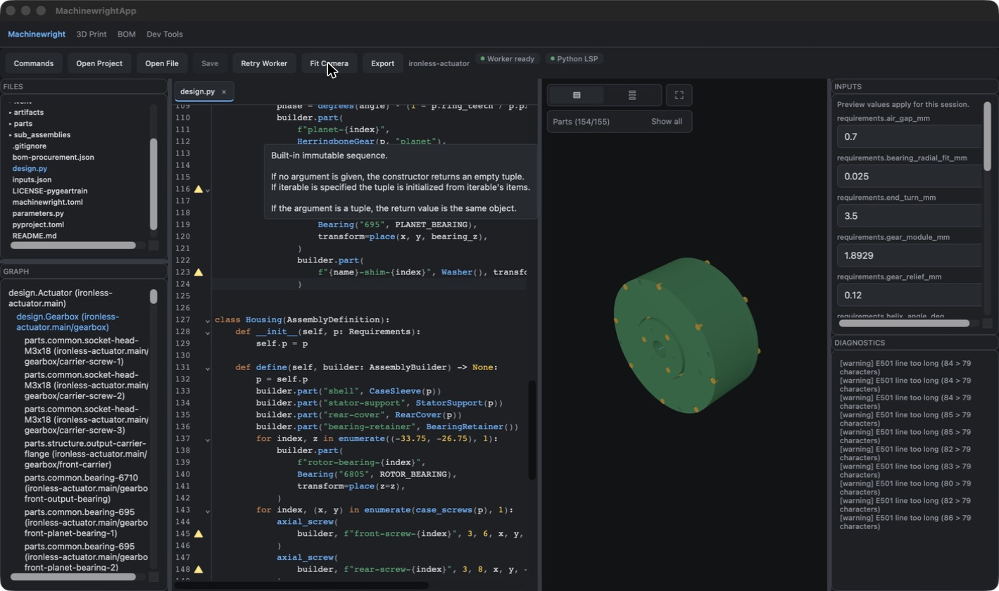
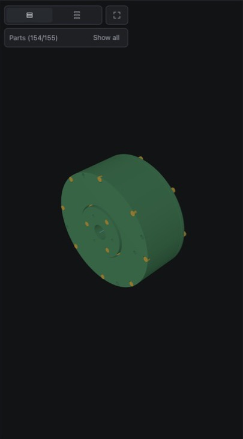
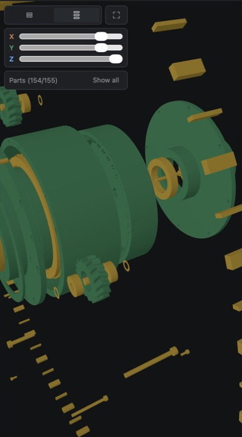

The Machinewright app opens a project folder, evaluates it through the project's Python worker, and shows the result live. These screenshots use the *ironless-actuator* sample project.

## The workspace

- **Files** (top left) browses the project. Select `design.py` to edit it.
- **Graph** (bottom left) lists the resolved assemblies and parts, such as `design.Gearbox` and its fasteners and bearings. Selecting a node highlights it in the viewport and links to its source.
- **Editor** (center) is a Python editor with syntax highlighting, folding, search and Command-S to save. The project-local language server provides completions (Control-Space), hover documentation, Go to Definition (F12) and inline diagnostics.
- **Viewport** (center right) is the 3D view. Toggle between *Assembled* and *Exploded* views and use **Fit Camera** to frame the model.
- **Inputs** (top right) exposes the active template's fields. Change a value and the preview re-evaluates.
- **Diagnostics** (bottom right) shows warnings and errors from resolution and the language server.

The editor evaluates unsaved changes and keeps the last valid snapshot visible if a newer evaluation fails.

## Assembled and exploded views

The exploded view separates parts so you can check fit and assembly order. Use the part-count control to isolate groups, and click **Show all** to restore everything.

## Other tabs

- **3D Print** is a full-window view of your printer's bed. Configure the printer, **Generate Plates**, and **Export STLs…** for your slicer. See [3D printing plates](/docs/guides/3d-printing/).
- **BOM** lists purchased parts with supplier, SKU, cost and order status. See [BOM and procurement](/docs/guides/bom-and-procurement/).
- **Export** (`Cmd+Shift+E`) saves STEP or STL for the whole assembly or for selected parts. See [Exporting artifacts](/docs/guides/exporting-artifacts/).
- **Commands** opens the command palette.
