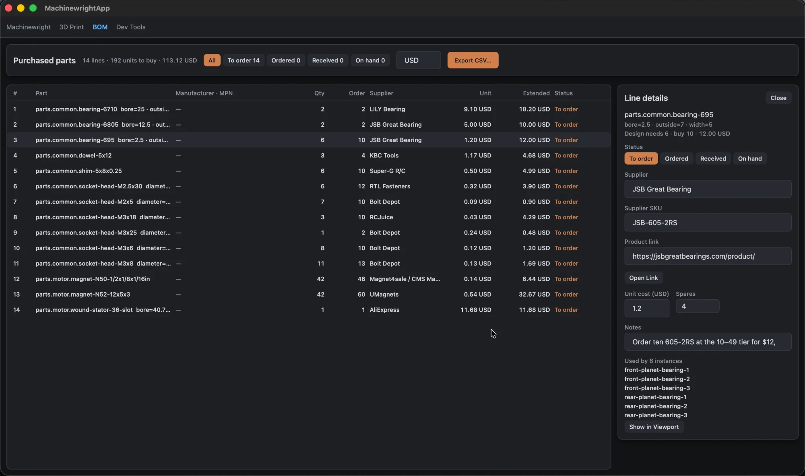

The **BOM** tab shows the design's purchased parts (material process `PURCHASED`). The lines are Machinewright's own BOM, the `bom.json` every evaluation writes, so grouping, quantities and manufacturer identity match `machinewright export bom` exactly.

For each line you can record supplier, SKU, product link, unit cost, spares, order status (*to order*, *ordered*, *received*, *on hand*) and notes. The tab totals units to buy and cost, and exports a CSV. **Show in Viewport** selects a line's instances in the 3D view.

## The procurement file

Procurement data is saved in `bom-procurement.json` in the project root, so it can be committed with the design. Opening the BOM tab prefills one record per purchased part, with a `needs` list naming what is still missing. A record looks like:

```json
{
  "part": "bearing-6805",
  "description": "bore=25 · od=37",
  "needs": ["supplier", "sku", "unit_cost"],
  "status": "to_order",
  "quantity": 2,
  "supplier": "", "sku": "", "url": "",
  "unit_cost": null,
  "spares": 0,
  "instances": ["front-bearing-1", "front-bearing-2"],
  "in_design": true,
  "line_id": "sha256:…"
}
```

Fields such as `part`, `quantity` and `instances` refresh from the design; the rest is yours. Records are matched by `line_id`, a digest of the part definition, revision and parameters, so sourcing survives unrelated edits. A part that leaves the design is kept with `in_design: false` in case it returns.

## From the command line

```bash
machinewright bom sync                         # prefill bom-procurement.json
machinewright bom list --unsourced --json      # lines still missing a supplier or price
machinewright bom set 4702b31a22e0 --supplier McMaster --sku 91290A115 \
    --unit-cost 0.12 --spares 2 --status ordered
machinewright bom export parts.csv             # BOM + sourcing as CSV
```

Commands read the newest `.machinewright/output/assembly-*.bom.json` (or `--bom`), accept a unique prefix of a line id, and write the file atomically. The app reads the file when the BOM tab opens, so reopen the tab after editing it externally.
